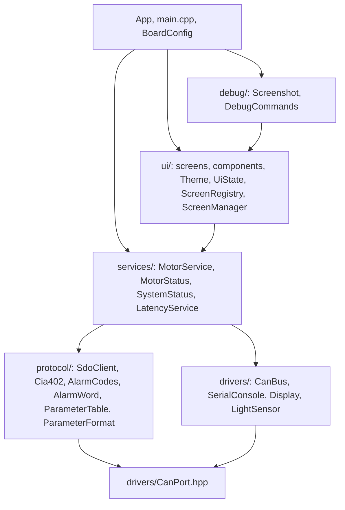
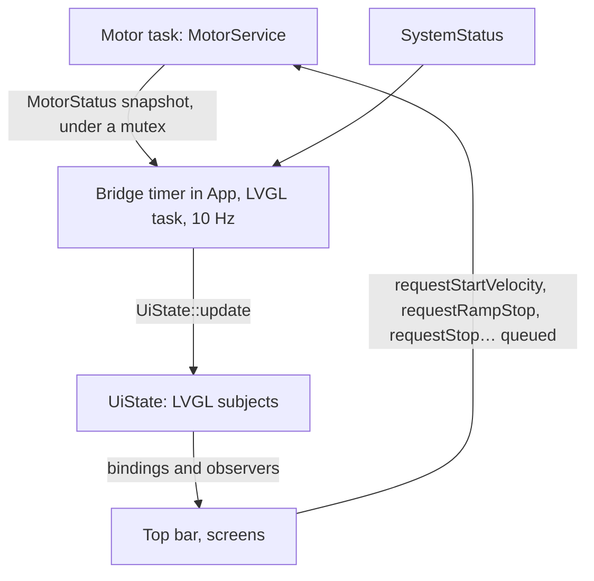

# Architecture

How the firmware is built, as of 2026-10-12 (end of the Parameters plan). Decisions behind it: D-007 (native ESP-IDF), D-014 (App class and layers), D-015 (state and command flow), D-016 (the motor keeps running across screens), D-017 (motion plots from SDO sampling), D-020 (`607D` widened for position mode), D-021 (turns from a console zero), D-022 (entering a motion screen ends the other mode), D-023 (the drive's heartbeat stops it on a lost bus), D-027 (parameter metadata generated from the Chinese manual), D-028 (edits are written at once; saving puts the console's session values back), D-029 (locked parameters).

## Toolchain

Native ESP-IDF 5.5.5 in C++, built with `idf.py`, VS Code with the Espressif ESP-IDF extension (D-007). The project is in `firmware/`:

| Path                                                 | What                                                                                      |
| ---------------------------------------------------- | ----------------------------------------------------------------------------------------- |
| `CMakeLists.txt`                                     | Project file. Picks the rev 3.x defaults unless `SDKCONFIG_DEFAULTS` is given             |
| `sdkconfig.defaults`                                 | Shared settings (flash, PSRAM, caches, console UART, FreeRTOS, LVGL)                      |
| `sdkconfig.rev3.defaults`, `sdkconfig.rev1.defaults` | The chip revision layered on top                                                          |
| `partitions.csv`                                     | NVS, PHY, 8 MB app, 7 MB storage                                                          |
| `main/`                                              | The application; `main/CMakeLists.txt` globs every source, `idf_component.yml` pins the BSP and LVGL |
| `fonts/source/`                                      | Font TTFs and licences; generated fonts are in `main/ui/fonts/` ([UI design](UI%20design.md)) |
| `dependencies.lock`                                  | Resolved component versions; committed                                                    |
| `build/`, `managed_components/`                      | Generated; `build/sdkconfig` is the resolved configuration                                |

## Layers

Folders under `firmware/main/` by layer. Dependencies point down only.

| Layer | Rule |
|---|---|
| `ui/` | The only code that touches LVGL, besides `debug/` and `drivers/Display`. Reads state from `UiState`, sends commands through the services' request methods |
| `services/` | Owns tasks and the bus. Never includes LVGL or `ui/`. Publishes snapshots (`MotorStatus`) |
| `protocol/` | Plain C++: no FreeRTOS, no ESP-IDF, no LVGL. Reaches the bus only through `CanPort`, so it can run against a fake bus on a PC |
| `drivers/` | Hardware: the TWAI controller (`CanBus` implements `CanPort`), the console UART, display bring-up, the light sensor on the continuous ADC |
| `debug/` | Tools for working from a PC: serial commands and screenshots (the font specimen is a registry screen, `ui/screens/SpecimenScreen`, not on home) |

`MotorService` (NAV-006) is the single owner of the bus and the drive. One task connects (identity, version strings, node settings, stop-related values, speed limits, counts per turn and the console zero, stopping a drive left running, the undervoltage limit of D-005, the heartbeat of D-023), polls at about 10 Hz, and runs queued commands. STOP is a sticky flag rather than a queued command: it discards the queue, cancels a start in progress, and runs a quick stop (D-008) followed by power stage off. Between polls it reads velocity, position and current about every 20 ms (three SDO reads) into a ring buffer of `MotionSample`s, with the velocity and position targets the drive is following (D-017). The same reads keep the live values current during stops and state walks, which don't poll. Charts fetch new samples with `getMotionSamples()` on their own 20 ms timer rather than through the 10 Hz `UiState` bridge, so lines move one sample at a time. Frames that aren't the awaited SDO response reach it through `SdoClient::setOtherFrameHandler`, which is how EMCY messages are recorded. The ESP-IDF task watchdog (`CONFIG_ESP_TASK_WDT_PANIC`) resets the console if the motor task hangs; `keepAlive()` resets it in every loop and wait. The task has a 12 KB stack: 6 KB overflowed when ending position mode for the Torque screen (2026-10-13), since each level of that path holds a copy of the status snapshot; it logs a warning once if less than 1 KB is ever left (peak use measured at about 6.5 KB).

### Motion modes

The service runs one mode at a time (`MotionMode`: none, velocity, position, torque), published in the status with `isRunning` and, for position, `isHalted`. A run also ends when the drive leaves Operation enabled by itself (a fault, or a self-resetting alarm such as undervoltage); the message names the alarm.

| Mode | Commands | What the task does |
|---|---|---|
| Velocity | `requestStartVelocity`, `requestRampStop`; targets `setTargetVelocityRpm`, `setAccelerationRpmPerSecond` | `6060 = 3`, state walk, `60FF`; target changes apply at once; ramp stop writes 0 and waits for standstill, then powers off |
| Position | `requestGoPosition`, `requestHalt`, `requestRelease`, `requestZeroHere` (the console zero to the current position, D-021; nothing written to the drive); targets `setPositionTargetMilliturns`, `setPositionRelative`, `setMoveByMilliturns`, `setMoveSpeedRpm` and the shared acceleration | `6060 = 1`, `607D` widened if needed (D-020), state walk, 100 ms wait, then each target with the bit 4 / bit 12 handshake; speed or ramp changes mid-move re-send the target; halt is bit 8, release powers off |
| Torque | `requestStartTorque`, `requestTorqueStop`; targets `setTargetTorquePerMille`, `setTorqueSlopePerMillePerSecond` | `6060 = 4`, slope `6087`, state walk, then `6071` (0.1 % of the rated current); target and slope changes apply at once. The speed is held at the drive's limits `2007:10`/`:11`. Smooth stop: target 0 at the slope, then a quick stop to standstill and power off. `protocol/TorqueUnits.hpp` converts to and from mN·m with the rated torque `6076` for the screen (Torque mode) |
| Step test | `requestStartStepTest`, `requestStopStepTest`; settings `setStepTestPosition`, `setStepTestVelocities`, `setStepTestStepMilliturns`, `setStepTestMoveSpeedRpm`, `setStepTestAccelerationRpmPerSecond`, `setStepTestDwellMs` | Runs the velocity or position mode above with `isStepTest` set: a timer in the task loop switches between speed A and B, or makes a relative move of the step and back. Its own ramp (default 30 000 rpm/s) and speed (default the speed limit); a ramp steeper than `60C5`, `60C6` or `6085` raises them for the test, `6085` first, and puts them back when it ends. Ends with STOP TEST (ramp or halt, then off), the Tuning tab being left, or the motor stopping for any reason. The motion screens' targets are saved and put back |
| All | `requestStop` (sticky quick stop), `requestFaultReset`, `requestMotionScreen` | A motion screen's `onEnter()` ends the other modes: ramp stop for velocity, halt and release for position, smooth stop for torque (D-022) |

### Connect, faults and the search

- **Connect order (D-024):** identity and node settings, then the reads that are evidence (the fault record: alarm history `1003`, reactions `200E`, error register `1001`; and the run-check values: control mode, input functions and states, homing method), the motor's own values of the parameters the console sets (below), and only then the run-time writes (undervoltage limit D-005, heartbeat D-023). The fault record is read again when it may have changed: after an EMCY, a new `603F` or a reset.
- **Fault data lives in the service.** `MotorStatus` carries the fault record and run checks with a version number; the session log (`getSessionLog`, a ring of `SessionLogEntry`: alarm, cleared, reset and by what, connected, lost, powered off, restored or refused, with console time and the motion at that moment) is a model with its own version. Screens rebuild their lists when a version changes.
- **What counts as an active alarm** (`isAlarmActive`, `isHaltAlarm` in `Cia402.hpp`): the statusword's fault or warning bit, or a non-zero `603F` in Operation enabled. A stall halts the motor that way without either bit (bench 2026-10-11). `603F` in any other state without a bit is a leftover, such as the `0x7501` for a second after power-on.
- **Stall:** a run that sees `603F` = `0x2312` reads the stall reaction `200E:02` once; if it is halt and hold (the factory one, which keeps holding at up to the rated current) the console quick-stops and powers off (`checkStall`). A fault stops by itself; a warning or ignore is left running, since someone chose it. A failed read stops.
- **Resets:** RESET FAULT holds controlword bit 7 for 60 ms, disables the drive, ends the run and reports what is left. START and GO send the same reset first when the drive is in Fault or `603F` is non-zero, since a stall stays latched and halts the next run at once; each reset is logged (D-024).
- **Restore defaults (D-025):** `1011:01` only; below 80 % of the rated voltage `2000:07` the service lowers it at run time first. It reads `603F` right after the write to report a refusal (`0xFF02`), then applies the run-time settings again, since a restore resets them at once.
- **The search (D-026):** after about 3 s without an answer at node 1, 1 Mbit/s, the connect loop steps through node 1 at the other eight bitrates, then node IDs 2–127 at 1 Mbit/s, one step per loop with a 30 ms SDO timeout, and counts full sweeps. `CanBus::setBitrate` replaces the TWAI node (drain, disable unless bus-off, wait 10 ms, delete, create). A lost drive starts it again at the default.

Position targets are in milliturns from the console zero (D-021); the service converts them to user units with the counts per turn from `608F` and `6091`, and always sends an absolute `607A`. A relative move adds to the last target while the drive is following or holding it, otherwise to the actual position. The service also publishes derived flags for the screen, such as the relative move's base and whether GO would move the shaft.

## Parameters

The Parameters plan (M6), on the Tune & parameters screen.

- **The table (D-027):** `protocol/ParameterTable.hpp/.cpp` was generated (by a tool that didn't come over to this repository) from the Chinese manual's object dictionary and a factory parameter dump: 446 entries in 21 groups with index, type, access, when a change takes effect, unit, decimals, range, factory value, English name and description, named values and flags. Objects the manual doesn't document are left out. Flags: `LOCKED` (D-029: `200C:01`, identity, motor constants and calibration), `SETUP_ONLY` (node ID and bitrate, written only by the Setup tab's danger group), `CONSOLE_OWNED` (what the motion screens set: control mode, operation mode, profile speed and ramps) and `SESSION` (the console's run-time values: undervoltage limit, heartbeat, `607D`). Hand-fixed names, descriptions and labels live in the generator; its report lists every repair.
- **`ParameterFormat`** (protocol, plain C++) turns a raw value into text: named values, hex codes, decimals, and position units as turns, rpm and rpm/s. The same scale converts back, so the number pad edits position units in those units. It also says what is editable: read-write and not locked, setup-only, console-owned or a session value; while running only "immediate" ones.
- **The read model:** `requestReadParameters()` reads every entry in chunks per loop pass (100 stopped, 20 running) into the service's `ParameterValue` array, with a version subject; screens fetch a copy on a change. At connect the service captures the motor's own values of the parameters it writes (`hasOwnValue`), unless the heartbeat is already on, which means an earlier console session (`hasEarlierSessionValues`).
- **Edits (D-028):** `requestWriteParameter()` writes at once, reads back, and records an unsaved change with the value from before the first write; a change back to that value drops it. The list clears on reconnect, since a power cycle loses it. `requestRevert()` writes each one back.
- **Save (D-028):** `requestSave()` puts the console's session values back to the motor's own (or factory values when unknown), keeps the 12 V undervoltage limit if the bus is at or below the motor's own limit, lowers the rated voltage `2000:07` to 20 V if the bus is under 80 % of it (flash writes need that, D-025), writes `1010:01`, reads `603F` after 300 ms for a refusal (`0xFF02`), then applies the session values again. `getSavePreview()` gives the confirm what will end up in flash.
- **Node ID and bitrate** go through the same write and save, from the Setup tab: refused while running or powered, and only one of the two away from its default at a time, so the search (D-026) finds the motor after the power cycle.
- **A `6085` write** moves the console's acceleration limit at once (D-019).

## App and startup

`main.cpp` creates a static `App` and calls `begin()`. `App` owns every part as a member, declared in dependency order; dependencies are constructor arguments. `begin()` starts them in sequence:

1. **Display** (`drivers/Display`): display, touch, LVGL task. Its own copy of the BSP's display start without the backlight set-up: the board lights the backlight at power-up, and the BSP's PWM set-up made it flicker. The panel's white while it initialises runs into the white splash (bench 2026-10-11).
2. **Services:** CAN controller, then the motor task.
3. **UI**, holding the display lock: theme, `UiState` (initialised and filled once), the bridge timer, the screen manager and the home screen.
4. **Serial console**, with the commands from `DebugCommands`.

A part that fails to start is logged and recorded in `SystemStatus`; the rest still starts, and the top bar shows "CAN failed to start".

## State and commands

- **State flows down.** The motor task publishes a `MotorStatus` snapshot under a mutex. One LVGL timer copies it into `UiState`, which holds LVGL subjects grouped by domain (`state.motor.*`, `state.system.*`). LVGL notifies bound widgets only when a value changes.
- **Integers in native units.** Subjects hold the drive's units (bus voltage in 0.1 V); widgets format them (`Bindings::bindFixedPoint`, `lv_label_bind_text`). Strings only for text. The one converted value is motor current: `6078` is per mille of the rated current, so the service publishes it in 0.01 A next to the raw value.
- **Commands flow up.** Screens call the service's request methods, which only queue; the motor task acts on them.
- **Events** are a value plus a sequence number in the snapshot (`message`, `messageSequence`), so the UI reacts even when the same message repeats.
- **Lists** are models owned by the service with a count or version subject in `UiState`; a screen fetches or rebuilds when it changes. The motion samples for the charts work this way (with their own timer rather than a subject), as do the alarm history, the session log, the parameter values and the unsaved changes.
- **Targets live in the service.** Motion targets (speed, acceleration, position target, relative distance, move speed) are held by `MotorService` and published back, so a screen opened later starts from them (D-016). So are their limits, read from the motor on connect (D-019). Only truly screen-local state (a half-typed number) stays in the screen.

### Latency

`LatencyService` (D-034) does not touch the bus. `drivers/LightSensor` reads the DFR0026 on GPIO49 with ADC2 in continuous mode at 20 kHz; the conversion-done ISR only queues the frame's timestamp, and the service's task (priority 4, 6 KB stack) reads frames of 256 samples, smooths over 1 ms and detects edges against a threshold with hysteresis learned from one dark and one bright phase. It drives the LED on GPIO46, times the LED turning on to the screen crossing the threshold (the off edge is waited for, not counted: D-035), holds each state for at least 200 ms or the running median plus a random 0–100 ms (so the camera's frame clock is sampled evenly), and stops after 100 samples or three misses in a row. A run ends back at aiming with the result kept (`hasResult`, `isFailed`). The self-test (sensor against the LED, 200 samples with 5–10 ms holds, about 10 s) passes under 1 ms. The bridge copies `getStatus()` into `UiState::Latency` each tick; the chart fetches the samples on a version change. The sensor runs only while the Latency screen is open. `latency demo` fills synthetic samples to check the screen without a sensor.

## UI structure

| Part | What |
|---|---|
| `ScreenRegistry` | One table row per screen: id, serial name, title, icon, card text, factory, flags. A row without a factory is a disabled card |
| `ScreenManager` | Implements `Navigator` (open, back, home) with a back stack of up to 8 screens. Owns the top bar and the overlay layer |
| `Screen` | Base class: `create(content)`, `onEnter()`, `onLeave()`, timers via `addTimer()` deleted with the screen |
| `UiContext` | What screens and components get: `state` (UiState), `motor` (service requests), `navigator`, `latency` (latency service requests) |
| `TopBar` | Back, title, drive identity, state and error badges, bus voltage, CAN state, STOP; on LVGL's top layer so it survives screen changes |
| Overlay layer | Above the top bar, for dialogs (the number pad, confirm and info dialogs); emptied on every navigation. Reached through `Navigator::getOverlayLayer()` |
| Components | Functions with an options struct when they only render or bind (`createButton`, `createHomeCard`, `createBadge`, `createStopButton`, `createValueTile`, `createInfoPanel`, `createNumberControl`, `createSegmentedToggle`, `createTrendChart`, `createTabStrip`, `createParameterList`, `createSetupList`, `createTuningList`, `createTuningTab`, `createCalibrateTab`, `createSearchPanel`, `createUnsavedBar`, `createLevelBar`, `createLatencyChart`, `openOptionPicker`); classes when called after creation (`TopBar`). A component with state after creation keeps it in a heap struct freed on `LV_EVENT_DELETE`. Dialog helpers shared by screens sit in `ui/`: `ParameterEditor` (number pad for a parameter), `RestoreDefaults` (the restore confirm), `StepTestValues` |

Navigation is deferred to the next LVGL cycle, so a button can navigate away from its own screen. `onLeave` runs before the next screen is built. The motor keeps running across screens (D-016); motion screens start their controls from the targets in `UiState`.

## Threading rules

| Task | Touches |
|---|---|
| LVGL task | All LVGL objects, `UiState`, screens, the bridge timer |
| Motor task | The CAN bus, the drive, its own snapshot (under its mutex) |
| Serial console task | Only through the display lock (`DisplayLock`, an RAII wrapper over `bsp_display_lock`, LVGL's mutex) for anything in the UI |

- Only the LVGL task, or code holding the display lock, touches LVGL.
- Observer and timer user data must outlive the widgets: use `UiState` or app-lifetime objects, never the screen (a screen object is deleted right after its widgets, so nothing may call back into it later).
- `lv_async_call` is for code inside an LVGL event handler that would delete its own widgets (`ScreenManager` uses it for navigation).

## Debugging from a PC

Serial commands (`help` lists them): `screenshot`, `torque <0.1 %>` and `torque stop` (fixed targets 0, 50, 100, 200, 300, 500, -100, -300; from the torque spike), `open <screen>`, `back`, `home`, `state`, `specimen`, `splash` (the start-up splash, held until tapped), `dump` (log every object the drive answers; reads only), `params` (read and log every parameter in the table), `stack` (least free stack of the motor and LVGL tasks), `perf` (CPU share per task over 2 s, free heap, LVGL object and timer counts), `search` (run the whole search with the motor at the default). `tools/screenshot.py COM6 --open home` captures screens; see [Development setup](Development%20setup.md).
