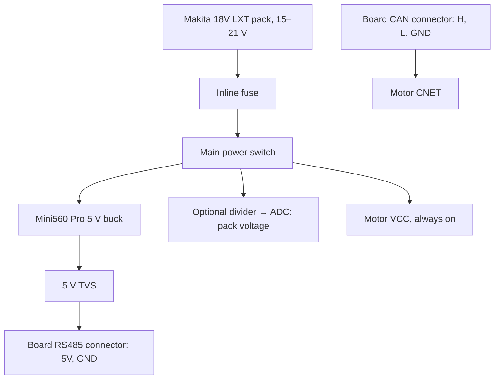

# Hardware

Sources: Waveshare product page, docs and schematic (`ESP32-P4-WIFI6-Touch-LCD-7B.pdf`), read 2026-10-08 and 2026-11-20. Nothing here is measured yet unless it says so.

**The board section applies to Sparky as it is.** Power, CAN wiring, the pin map's extra parts and the enclosure describe the NiMotion debug console this firmware came from (a handheld case on a Makita pack, one motor on an M12 cable). Sparky uses the same board, pack and motors, but its own wiring isn't written down yet.

## Board: Waveshare ESP32-P4-WIFI6-Touch-LCD-7B

- [Product page](https://www.waveshare.com/esp32-p4-wifi6-touch-lcd-7b.htm), [docs](https://docs.waveshare.com/ESP32-P4-WIFI6-Touch-LCD-7B), [schematic](https://files.waveshare.com/wiki/ESP32-P4-WIFI6-Touch-LCD-7B/ESP32-P4-WIFI6-Touch-LCD-7B.pdf), [3D model](https://files.waveshare.com/wiki/ESP32-P4-WIFI6-Touch-LCD-7B/ESP32-P4-WIFI6-Touch-LCD-7B-3D.zip), [examples](https://github.com/waveshareteam/ESP32-P4-WIFI6-Touch-LCD-7B)
- ESP32-P4NRW32: dual-core RISC-V 360 MHz, 32 MB PSRAM in package, 32 MB flash.
- 7" IPS 1024×600 MIPI-DSI (EK79007), GT911 5-point capacitive touch. Backlight PWM on GPIO32.
- ESP32-C6 co-processor over SDIO for Wi-Fi 6 and BLE 5 (needs `esp_hosted`).
- microSD, USB-A host, two USB-C (native USB, and CH343P USB-UART for flashing), ES8311 audio with speaker output, no buzzer.
- **CAN:** TJA1051T/3 transceiver, TX GPIO22, RX GPIO21. ESD protection only, **not isolated**. 120 Ω termination on a jumper/solder bridge (marked "NC / 120R" on the silkscreen). The P4 has 3 TWAI controllers, classic CAN only.
- RS485 (THVD1406, GPIO26/27), UART, I2C and two 12-pin GPIO connectors, all PH2.0.
- 164.28 × 99.17 mm, five M2.5 SMT standoffs.
- **Chip revision:** boards ship with P4 rev 1.3 or rev 3.x. Firmware built for one does not boot on the other. **Ours is rev v3.2** (esptool, 2026-10-08).
- **Programming:** the "USB TO UART" USB-C port (CH343P, shows up as "USB-Enhanced-SERIAL CH343", COM6 on the development PC). Windows 11 installs the driver itself. The console UART is GPIO37/38, the same pins as the PH2.0 UART connector, so that connector is not free while logging is on.
- **USB power alone is not enough** from a weak port or hub: the board brown-out boot-loops. Power it from 5 V on the RS485 connector (D-004) or a charger on the other USB-C port, and use USB for data.

### Connectors and on-board parts

From the Waveshare product page (board overview, read 2026-10-13). Numbers are the ones on Waveshare's labelled photo.

| #   | Part                                                       | Notes                                                                                   |
| --- | ---------------------------------------------------------- | --------------------------------------------------------------------------------------- |
| 1   | ESP32-P4-Core module                                       | ESP32-P4NRW32 and 32 MB NOR flash                                                       |
| 2   | ESP32-C6-MINI-1                                            | Wi-Fi 6, BLE 5 over SDIO                                                                |
| 3   | C6 UART header                                             | For flashing the C6: hold C6_IO9 low at power-on and the P4 in download mode, then flash over C6_U0RXD/TXD (Waveshare FAQ) |
| 4   | ES8311 audio codec                                         |                                                                                         |
| 5   | ES7210 echo cancellation / mic ADC                         | Dual on-board microphones                                                               |
| 6   | MIPI-DSI connector                                         | The 7" panel                                                                            |
| 7   | Touch connector                                            | GT911                                                                                   |
| 8   | MIPI-CSI connector, 2-lane                                 | 15-pin 1.0 mm FPC, takes Raspberry Pi FPC cameras. OV5647 camera works (2026-11-10)    |
| 9   | MX1.25 battery connector (J4)                              | 1S Li-ion, forward polarity. Unused                                                     |
| 10  | PH2.0 speaker header                                       | Non-polarised                                                                           |
| 11  | RTC battery holder                                         | 1220 size, rechargeable 3–3.3 V cells only                                              |
| 12  | ON/OFF switch                                              | Bypassed by our supply (see Power)                                                      |
| 13  | Status LED                                                 |                                                                                         |
| 14  | USB-A, USB 2.0 high-speed OTG                              | Fed from `Core_5V`                                                                      |
| 15  | USB-C, native USB 1.1 full-speed                           | Power, flashing, debugging                                                              |
| 16  | USB-C, USB TO UART (CH343P)                                | Power, flashing, console (our programming port)                                         |
| 17  | RESET button                                               |                                                                                         |
| 18  | BOOT button                                                | GPIO35; hold at reset for download mode                                                 |
| 19  | PH2.0 4-pin I2C                                            | SCL, SDA, GND, VCC (3V3/5V selectable by solder bridge)                                 |
| 20  | PH2.0 4-pin UART                                           | Shared with the console UART                                                            |
| 21  | PH2.0 4-pin CAN                                            | L, H, GND, 5V                                                                           |
| 22  | PH2.0 4-pin RS485                                          | B, A, GND, 5V; our 5 V supply input (D-004)                                             |
| 23  | Two on-board microphones                                   |                                                                                         |
| 24  | Two PH2.0 12-pin GPIO headers (P3 left, P1 right)          | 17 free GPIOs, see Pin map                                                              |
| 25  | microSD slot                                               | SDIO 3.0                                                                                |
| 26  | Reserved area for a rechargeable battery                   |                                                                                         |

GPIO header pin labels as printed on the silkscreen (Waveshare photo; pin 1 end not verified):

- **P3 (left):** 3V3, GND, IO3, IO2, IO4, IO5, IO28, IO29, IO30, IO31, IO34, IO36
- **P1 (right):** BAT, GND, 3V3, VO4, GND, IO46, IO47, IO48, IO49, IO50, IO51, IO52

## Power

The board accepts only 5 V (USB-C) or a 1S Li-ion on J4. It cannot take pack voltage. See D-003 and D-004 in [Decisions](Decisions.md).

No custom power board and no switched motor power (D-013): modules and wiring only.

### Pack

- Makita LXT 18V is 5S Li-ion: about 21 V full, 18 V nominal, 15 V empty.
- Makita packs rely partly on the tool to stop discharging, so the console cuts off itself (D-005).

### Board supply through the RS485 connector

From the schematic: pin "5V" of the RS485 connector (and of the CAN connector) is the `Core_5V` rail with no fuse or diode. The PTC fuses F1/F2 are on the A/B lines only.

- **The onboard ON/OFF switch is bypassed.** It is a P-MOSFET (Q8, DMP2066) between `VCC_5V` (USB side) and `Core_5V`. Its body diode lifts `VCC_5V` to about 4.4 V; only the unused charger sits there.
- **USB stays safe to plug in.** Each USB-C input has an ideal-diode circuit (AO3401 + MMDT3906), so the 5 V supply cannot back-feed a PC.
- **`Core_5V` has no protection of its own.** The 5 V TVS is on the USB input, and the rail's capacitors are 10 V parts. The buck must be 5.0–5.1 V with soft start and no overshoot, with a 5 V TVS (e.g. SMBJ5.0A) at the connector.
- **Buck: Mini560 Pro 5V** (D-018). **Measured 2026-10-08:** 5.08 V with no load, 5.03 V at 2 A (21 V input), about 87% efficient; at 28 V input and 2 A it still regulates and reaches 76.6 °C after 2 minutes. Input rating 7–32 V is the seller's claim. Start-up overshoot not scoped yet.
- `Core_5V` also feeds the USB-A host port; keep that in mind for current.
- PH2.0 contacts are rated about 2 A. **Measured 2026-10-08:** idle 0.58 A at 5 V (2.91 W), on the factory firmware. It does not boot with a 0.5 A supply current limit: start-up inrush and the Wi-Fi start-up spike pull the voltage down until the P4 resets. It boots fine at 2 A. Still to measure: backlight full vs minimum, Wi-Fi active, start-up peak.
- At 2.91 W plus about 10% buck loss, a 5 Ah (90 Wh) pack runs the board alone for roughly 25 hours. The motor is the real load.
- **Measured 2026-10-11, whole system from 18 V** (bench supply into the buck, our firmware, display on, motor on the same supply): **0.203 A, 3.67 W** idle with motion working, **0.221 A, 3.97 W** with the motor running unloaded at 600 rpm. Not yet measured: the motor under load on 18 V.
- **Estimated runtime** (not measured): a 5 Ah pack holds about 90 Wh, of which roughly 75–85 Wh is above the 16.5 V cutoff (D-005). At about 4 W that is 19–21 hours; a bench session with some load (a guessed 6–8 W average) gives 10–13 hours, a 3 Ah pack about 60% of that. The working-day requirement looks comfortable.
- J4 (1S battery) stays empty.

### Motor supply

- Straight from the pack after the fuse and main switch, always on while the pack is in and switched on (D-013). On the prototype the main switch is the battery adapter's rocker switch and there is no fuse yet. Power cycles for save, factory reset and node changes are done by the operator, prompted by the console.
- No current sense: the drive's own current reading (`6078`, 0.01 A) is shown instead.
- BLM42 motors accept 12–36 V, BLM57 16–52 V. The pack range fits, except the BLM57 near empty, which the cutoff covers.
- Regenerative energy goes to the drive's internal braking resistor; a reverse-blocking FET before the motor is fine.

## CAN wiring

- Board CAN connector (PH2.0 4-pin): L, H, GND, 5V (silkscreen order). **Never connect 5V to the motor.**
- Motor CNET pin order **differs between frame sizes** (from the BLM manuals):

| Pin | BLM42 (BLM4203B, BLM4205B) | BLM57 (BLM5709B) |
| --- | -------------------------- | ---------------- |
| 1   | GND                        | CAN_H            |
| 2   | CAN_L                      | CAN_L            |
| 3   | CAN_H                      | GND              |

- Pin 1 is the CNET pin next to the I/O connector (from both manual drawings; **measured 2026-10-08** on a BLM42: CNET pin 1 to power GND ≈ 0 Ω).
- One cable per frame size, or a keyed adapter. Connector part numbers on the motor side are still to be identified.

### BLM42 cable (built 2026-10-08)

| Signal | Wire   | Board CAN pin | BLM42 CNET pin |
| ------ | ------ | ------------- | -------------- |
| CAN_L  | green  | L             | 2              |
| CAN_H  | purple | H             | 3              |
| GND    | blue   | GND           | 1              |
| —      | —      | 5V (empty)    | —              |

Not usable on a BLM57: its pins 1 and 3 are swapped (CAN_H and GND).

### Motor cable through the M12 connector (prototype, 2026-10-11)

The prototype console has a 5-pin M12 panel connector on the case, all five pins used, carrying pack power and CAN to the motor. The cable is a removable M12 cable made for the console (labelled "PTU DEBUG"): one jacket that splits at the motor end into the CAN plug for CNET and a power branch to the motor's power input. The CNET plug is keyed, so it can't go in the wrong connector or the wrong way round; only the console end can be wired wrong. Wire colours as reported by the user; M12 pin numbers not recorded:

| Wire  | Signal         | Console side                 |
| ----- | -------------- | ---------------------------- |
| Black | Power ground   | Pack or bench supply −       |
| Grey  | Power positive | Pack or bench supply +       |
| Brown | CAN ground     | Board CAN GND                |
| Blue  | CAN H          | Board CAN H                  |
| White | CAN L          | Board CAN L                  |

- Termination: the board's 120 Ω is fitted (**measured 2026-10-08**: H–L = 120 Ω at the board connector with a BLM42 plugged in, so only one terminator is on the bus). The BLM42 most likely has no internal termination (unverified: confirm by measuring with the motor unplugged; it should still read 120 Ω). One terminator is fine for a short bench cable.

## Pin map

GPIOs in use or reserved by the board. Free GPIOs for our own hardware are on P1 and P3.

| GPIO                       | Use                                                             |
| -------------------------- | --------------------------------------------------------------- |
| 0, 1                       | 32.768 kHz RTC crystal                                          |
| 7, 8                       | I2C SDA, SCL (touch, codec, I2C connector)                      |
| 20                         | J4 battery voltage divider (unused, we have no J4 battery)      |
| 21, 22                     | CAN RX, TX                                                      |
| 26, 27                     | RS485 TX, RX (unused; connector carries board power)            |
| 32                         | Backlight PWM                                                   |
| 35                         | BOOT button                                                     |
| 37, 38                     | Console UART (to the CH343 USB-UART) and the UART connector     |
| 53                         | Speaker amplifier enable                                        |
| P1: 46                     | Latency LED (D-034), sourced from the GPIO through its resistor |
| P1: 49                     | Light sensor DFR0026 output, ADC2 channel 0 (D-034)             |
| P1: 47, 48, 50–52          | Free (P1 also carries GND, 3V3, `ESP_LDO_VO4`, BAT)             |
| P3: 2–5, 28–31, 34, 36     | Free (P3 also carries GND, 3V3)                                 |

**ADC-capable pins** (ESP-IDF v5.5 `components/soc/esp32p4/include/soc/adc_channel.h`): ADC1 is GPIO16–23, ADC2 is GPIO49–54. The only free ones are **GPIO49–52 on P1** (ADC2 channels 0–3). ADC1's pins are all taken (20 is the J4 divider, 21/22 are CAN, the rest are not on a header). On the P4, Wi-Fi runs on the C6, so ADC2 has no Wi-Fi conflict (inferred, unverified).

GPIO49 is taken by the light sensor (D-034). An optional pack voltage ADC would use one of GPIO50–52.

**Header facts for hooking things up** (schematic and ESP32-P4 datasheet v0.7, read 2026-10-19):

- **GPIO drive:** default drive strength 20 mA; at the strongest setting (PAD_DRIVER = 3) typ. 40 mA source at VOH ≥ 2.64 V and 28 mA sink at VOL = 0.495 V (datasheet table 5-4). An LED with a series resistor can hang straight off a GPIO.
- **ADC:** GPIO49–52 = ADC2 channels 0–3 (datasheet pin table); 100 kSPS; calibrated ranges 0–1000 mV at ATTEN0 and 0–1300 mV at ATTEN1 (table 5-6; the higher attenuations reach about 3.1 V on Espressif ADCs, not checked in this table).
- **Strapping pins are GPIO34–38** (datasheet §3). P3 carries GPIO34 and GPIO36; GPIO36 has a 10 kΩ pull-up to 3V3 on the board (R14) and takes part in the boot-mode selection (table 3-3: joint download boot needs GPIO35 = 0, GPIO36 = 1). Don't put anything on GPIO34 or GPIO36 that could pull them at reset; prefer P1 or the other P3 pins.
- **BAT on P1** is the battery terminal of the on-board ETA6098 Li-ion charger (cell connector J4), fed from `Core_5V`: a 3.7–4.2 V single-cell rail when a cell is fitted, nothing to do with our 18 V pack. Not a supply for our hardware.
- **`ESP_LDO_VO4` on P1** is the P4's internal LDO output 4, only decoupled and exported; its voltage is set by firmware. It also powers the IO domain of GPIO39–48 (VDD_IO_5), so **IO46–48 on P1 drive nothing until firmware turns LDO 4 on**: `LatencyService::begin()` sets it to 3.3 V (rail pass-through) at start-up. Found 2026-11-02 when the LED on IO46 stayed dark; source: a forum report for the ESP32-P4-NANO, the LED lights with it (confirmed 2026-11-02). Don't power anything from the VO4 pin; use 3V3.
- **Speaker:** ES8311 codec into an NS4150B class-D amplifier (bridge-tied output on the PH2.0 speaker header; enable on GPIO53). Not a GPIO: its output is the switched, filtered audio signal, and the audio path adds buffering delay, so it is no use as a timing reference or LED driver.

## Enclosure

3D-printed, built around the board's STEP model. **Prototype printed and in use (2026-10-11):** the case sits on a Makita LXT battery adapter, which has its own rocker switch that cuts power to everything, board and motor alike. Inside: the Mini560 buck (D-018) in the base and the M12 panel connector for the motor cable (above). Runs from a 3.0 Ah pack. Not yet: a fuse (the prototype relies on the pack's own protection), the 5 V TVS from the supply section (not fitted, unverified), and a confirmed USB-C opening for flashing.
