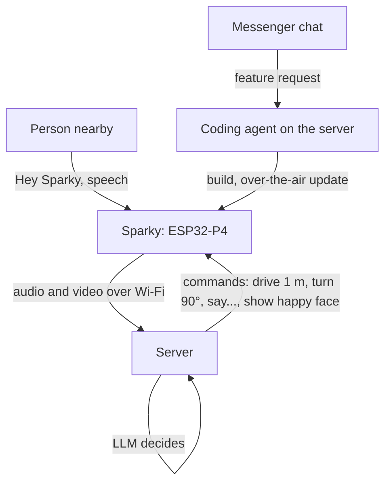

# Overview

Sparky is a small tracked robot that gives an LLM a body: it drives around, looks, listens and talks, and is meant to be a fun companion and assistant. It is also an experiment in a robot that changes its own code: new features are asked for in a chat and the LLM side writes, builds and ships them.

Status 2026-11-20: the robot drives with an Xbox controller over Bluetooth, and the camera streams to the display. Everything below the first section is the plan, not built yet.

## What exists

- **Body:** 3D-printed tub and tracks (`sw/`, `step/`, `bambu/`), two NiMotion BLM integrated servos on CAN (left node 2, right node 1, the left one mounted the other way round), a Makita 18 V LXT pack.
- **Board:** Waveshare ESP32-P4-WIFI6-Touch-LCD-7B on an upright mount: 7" touch display (the face), ESP32-C6 for Wi-Fi and Bluetooth, MIPI-CSI camera (OV5647), ES8311 codec and ES7210 with two microphones, a speaker header. See [Hardware](Hardware.md).
- **Firmware:** ESP-IDF 5.5.5 in C++ (`firmware/`), started from a NiMotion motor debug console built on the same board ([D-038](Decisions.md)). Tank mode at power-on: hold LB + RB to arm, left stick drives, right stick turns, Y toggles fast mode, B stops. See [Gamepad and tank drive](Gamepad%20and%20tank%20drive.md) and [Camera](Camera.md).

## Where it is going

- **The robot is the body and the reflexes.** The P4 runs no LLM. It listens for a wake word ("Hey Sparky"), streams audio and video to a server over Wi-Fi, and executes low-level commands: drive a distance, turn an angle, look somewhere, play audio, show an emotion on the screen. Anything that must react faster than a round trip to the server stays on the robot: stopping on a lost link, on an obstacle or on a fault.
- **The server is the brain.** An LLM sees and hears through the robot and decides where to go, what to look at, what to say and what to show.
- **Self-programming.** A coding agent on the server (driven from a messenger app; Hermes or similar) changes this repository, builds the firmware and ships it to the robot over the air. A new image keeps itself only after a self-test passes, so a bad build can't brick the robot or drive it away; the safety layer is code the agent doesn't change.

## Known gaps

- **Wi-Fi isn't up yet.** The C6's factory firmware doesn't answer ESP-Hosted 3.x, so it needs reflashing ([Open questions](Open%20questions.md)).
- **A hung P4 leaves the tracks running** at their last speed: the drives' heartbeat check (D-023) is fooled when two drives acknowledge each other's heartbeat.
- **Turns are approximate.** Tracks slip when they skid-steer and there's no IMU; calibration may be enough.
